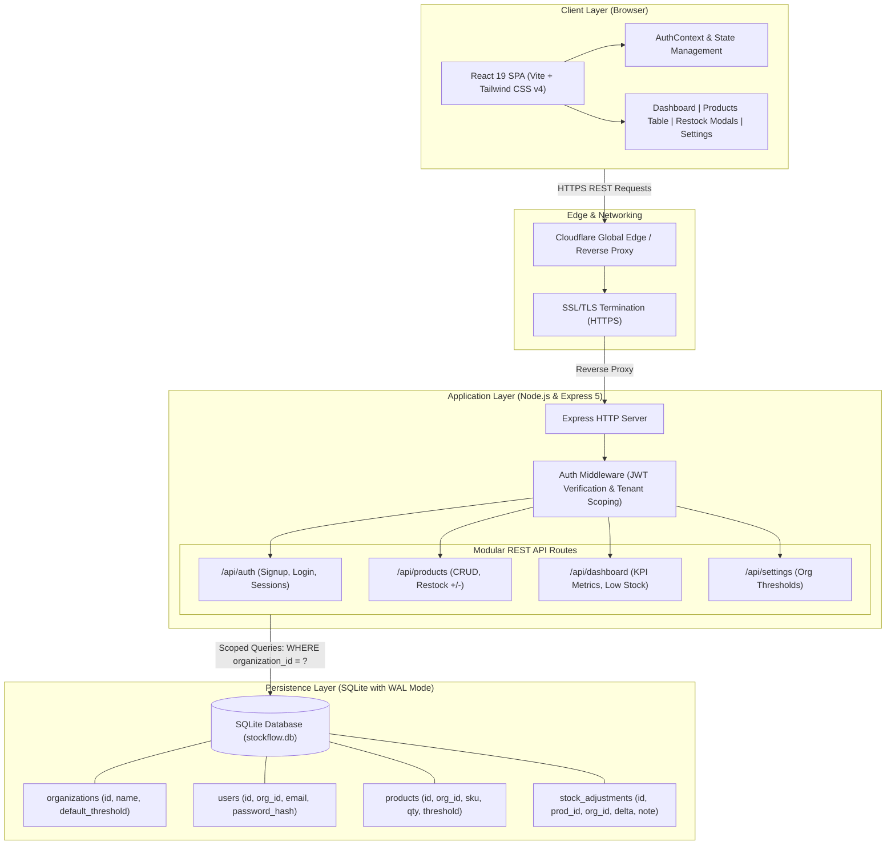
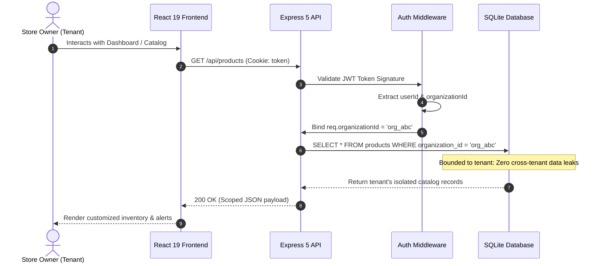

# StockFlow MVP (v0.1) - SaaS Inventory Management System

A multi-tenant SaaS inventory management web application built strictly according to the **Phase 1 – 6-Hour MVP PRD: SaaS Inventory Management System (StockFlow MVP)** specification.

---

## 🚀 Live Demo & Deployment URL

- **Live URL**: [https://kills-blake-ellis-fighters.trycloudflare.com](https://kills-blake-ellis-fighters.trycloudflare.com)
- **Demo Account**:
  - **Email**: `demo@stockflow.io`
  - **Password**: `StockFlow2026_Secure!`
  - **Organization**: `Demo Electronics Store`
- Or click **"Create Account"** to create your own isolated tenant organization!

---

## 🧭 Step-by-Step User Execution & Verification Flow

Follow these simple steps on the live application to test every feature from end-to-end:

### Step 1: Sign In or Register a Tenant Workspace
- Open the [Live Demo URL](https://kills-blake-ellis-fighters.trycloudflare.com).
- Click **"Use Demo Credentials"** at the bottom of the sign-in card (or enter `demo@stockflow.io` / `StockFlow2026_Secure!`).
- Click **"Sign In to Dashboard"**.
- *(Alternatively, click **"Create Account"** to register your own custom store organization)*.

### Step 2: Inspect Real-Time Dashboard Overview (FR-6)
- **Tenant Header**: Shows your active organization name (`Demo Electronics Store`).
- **4 Real-Time KPI Cards**:
  1. **Total Products**: Total unique cataloged SKUs.
  2. **Total Units on Hand**: Sum of all physical units in stock.
  3. **Low Stock Items**: Count of products requiring replenishment (highlighted in amber).
  4. **Est. Retail Value**: Total inventory value (`qty * selling_price`).
- **Low Stock Items Alert Table**: Displays products where `Quantity on Hand <= Threshold` (e.g., *USB-C Cable* with 3 units &le; 5).

### Step 3: Perform Quick Restock / Stock Adjustment (FR-5)
- In the **Low Stock Items Alert Table**, find the product row and click **"Restock / Adjust"** ($\updownarrow$).
- In the modal:
  - Select **"Add Units (+)"**.
  - Enter `10` units.
  - Enter an optional note (e.g., *"Supplier restock delivery"*).
  - Observe the **Live Stock Preview** update from `3` &rarr; `13`.
- Click **"Apply Stock Change"**.
- **Result**: Total units increase by 10, a success toast notification appears, and because stock is now 13 (&gt; 5), the item **automatically clears from the Low Stock alert table**!

### Step 4: Explore Catalog Search & Filters (FR-4)
- Click **"Products"** in the left sidebar menu.
- **Search**: Type `mouse` or `TECH-001` in the search bar. The table filters instantly.
- **Filter Pills**: Click **"Low Stock Only"** to view only distressed inventory. Click **"All Products"** to reset.

### Step 5: Create a New Product (FR-3 & FR-4)
- Click **"+ Add Product"** at the top right.
- Fill out the form:
  - **Name**: `Portable Power Bank 20000mAh`
  - **SKU**: `PWR-501` *(enforced unique within this organization)*
  - **Quantity on Hand**: `2` *(keep it low to test the alert)*
  - **Cost Price**: `14.50`
  - **Selling Price**: `34.99`
  - **Low Stock Threshold**: `5` *(or leave blank to inherit global default)*
- Click **"Create Product"**.
- **Result**: The product appears with a red **"Low Stock"** badge and immediately reflects in the dashboard alert table.

### Step 6: Edit & Delete with Confirmation (FR-4)
- Click the **Pencil (Edit)** icon on any row to modify price, description, or quantities.
- Click the **Trash (Delete)** icon. A safety modal confirms: *"Are you sure you want to permanently delete...?"*
- Click **"Delete"** to confirm removal.

### Step 7: Test Global Settings & Threshold Inheritance (FR-7)
- Click **"Settings"** in the left sidebar.
- Change the **Default Low Stock Threshold** from `5` to `20` and click **"Save Settings"**.
- Switch back to **Dashboard**: Any product with stock &le; 20 without an individual threshold is now automatically flagged as low stock!
- Set it back to `5` to restore default alerting.

### Step 8: Verify Multi-Tenant Data Isolation (FR-2)
- Click **"Sign Out"** in the sidebar footer.
- Click **"Create Account"** and register a second organization (e.g., `Apex Retail Store`).
- Log in and verify that:
  - The new store has its own clean, isolated catalog.
  - You can reuse the SKU `TECH-001` without conflict.
  - Zero data from Store A is accessible or visible.

---

## 📋 PRD Feature Compliance Matrix

| PRD Section | Requirement | Implementation Status | Notes |
| :--- | :--- | :---: | :--- |
| **FR-1** | Signup & Login | **Completed** | Full email/password validation, bcrypt hashing, JWT HTTP-only cookie sessions. |
| **FR-2** | Organization Context | **Completed** | Auto-creates tenant Organization record; all products and settings are strictly scoped by `organization_id`. |
| **FR-3** | Product Model | **Completed** | Name, SKU (unique per org), Description, Quantity on Hand, Cost Price, Selling Price, Low Stock Threshold, Timestamps, and `last_updated_by`. |
| **FR-4** | Product CRUD | **Completed** | Full Create, Read with Search & filter, Update modal, and Hard Delete with confirmation dialog. |
| **FR-5** | Simple Stock Updates | **Completed** | Direct edit in product modal + Quick "+/- Restock" inline adjustment modal with audit note. |
| **FR-6** | Dashboard Overview | **Completed** | Real-time KPI summary cards (Total Products, Total Units, Low Stock Alert Count, Retail Value) + dedicated Low Stock Items table. |
| **FR-7** | Global Settings | **Completed** | Configurable Organization Default Low Stock Threshold (default: 5), dynamically inherited by products without custom thresholds. |

---

## 🛠️ Tech Stack

- **Backend**: Node.js & Express 5 (REST API, JWT authentication, cookie sessions)
- **Database**: SQLite (via `better-sqlite3` with WAL mode and composite unique constraint `(organization_id, sku)`)
- **Frontend**: React 19 SPA, Tailwind CSS v4, Lucide Icons, Vite
- **Deployment**: Universal Docker container, Render Blueprint (`render.yaml`), Vercel config (`vercel.json`), Cloudflare Public Tunnel

---

## 🏛️ System Architecture

### 1. High-Level Multi-Tier Architecture


---

### 2. Multi-Tenant Request Isolation Flow


---

## 🧱 Database Schema

```sql
CREATE TABLE organizations (
  id TEXT PRIMARY KEY,
  name TEXT NOT NULL,
  default_low_stock_threshold INTEGER NOT NULL DEFAULT 5,
  created_at DATETIME DEFAULT CURRENT_TIMESTAMP,
  updated_at DATETIME DEFAULT CURRENT_TIMESTAMP
);

CREATE TABLE users (
  id TEXT PRIMARY KEY,
  organization_id TEXT NOT NULL REFERENCES organizations(id) ON DELETE CASCADE,
  email TEXT NOT NULL UNIQUE,
  password_hash TEXT NOT NULL,
  created_at DATETIME DEFAULT CURRENT_TIMESTAMP,
  updated_at DATETIME DEFAULT CURRENT_TIMESTAMP
);

CREATE TABLE products (
  id TEXT PRIMARY KEY,
  organization_id TEXT NOT NULL REFERENCES organizations(id) ON DELETE CASCADE,
  name TEXT NOT NULL,
  sku TEXT NOT NULL,
  description TEXT,
  quantity_on_hand INTEGER NOT NULL DEFAULT 0,
  cost_price REAL,
  selling_price REAL,
  low_stock_threshold INTEGER,
  last_updated_by TEXT,
  created_at DATETIME DEFAULT CURRENT_TIMESTAMP,
  updated_at DATETIME DEFAULT CURRENT_TIMESTAMP,
  UNIQUE(organization_id, sku) -- Enforces per-tenant SKU uniqueness
);

CREATE TABLE stock_adjustments (
  id TEXT PRIMARY KEY,
  product_id TEXT NOT NULL REFERENCES products(id) ON DELETE CASCADE,
  organization_id TEXT NOT NULL REFERENCES organizations(id) ON DELETE CASCADE,
  delta INTEGER NOT NULL,
  previous_quantity INTEGER NOT NULL,
  new_quantity INTEGER NOT NULL,
  note TEXT,
  created_by TEXT,
  created_at DATETIME DEFAULT CURRENT_TIMESTAMP
);
```

---

## 💻 Local Quickstart

### 1. Install Dependencies
```bash
npm install
```

### 2. Build Frontend
```bash
npm run build
```

### 3. Start Production Server
```bash
npm start
```
Open [http://localhost:5000](http://localhost:5000) in your browser.

---

## 🧪 Automated End-to-End Verification

To run the automated test suite testing auth, tenant isolation, CRUD, stock adjustment, dashboard metrics, and settings:

```bash
# In one terminal:
node server/index.js

# In another terminal:
node tests/test_api.js
```
